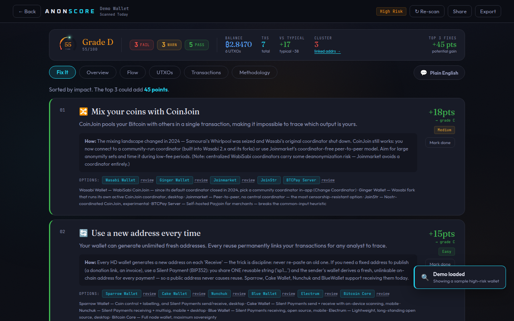
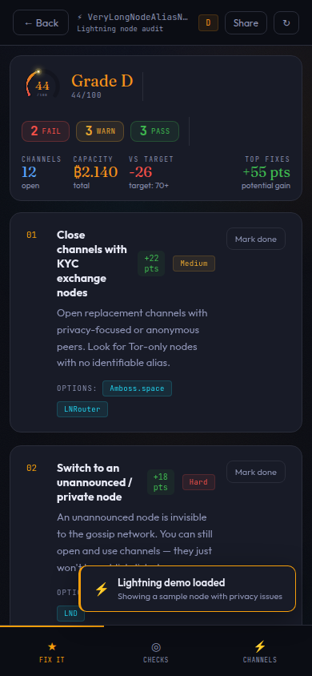
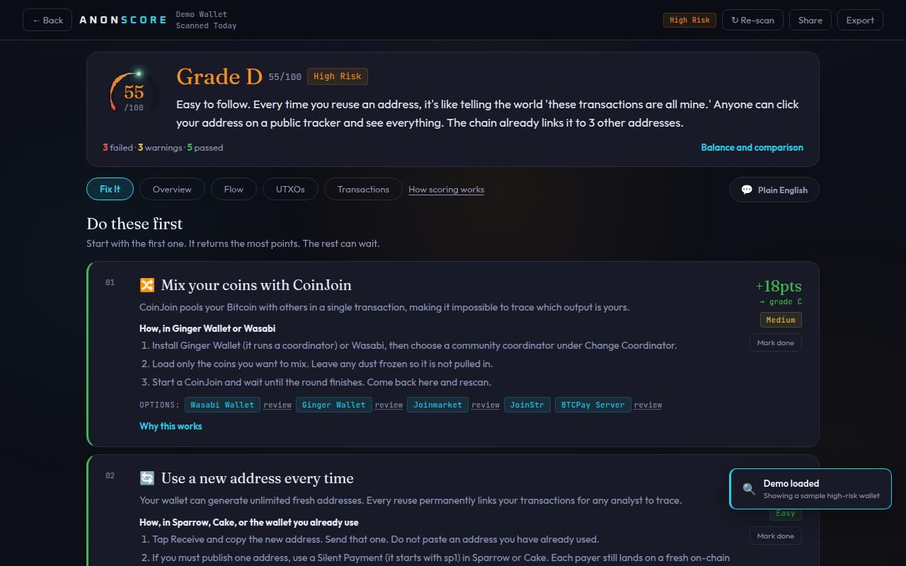
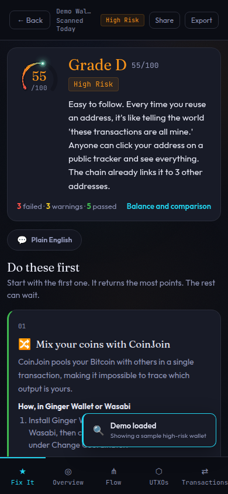
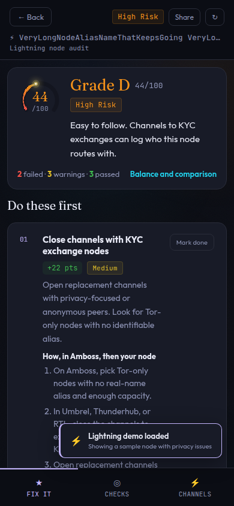

# Product push — 2 November 2026

Walked the app the way a first visit works, in headless Chrome at **1280×800** and **390×844**, on the build that already had PR #108 (paste, then Analyze, results open on the fixes). Samples stay in the browser: the risky wallet, the strong-privacy wallet, the Lightning demo, and the example xpub. The transaction was a confirmed txid handed to the Inspector through the same lookup the page uses, answered locally so the report could be read without an explorer. Screenshots are in [`docs/product-push/`](product-push/).

At each stop the question was the same: can someone tell, immediately, what the score is, why it landed there, and the next thing to do?

The landing from #108 holds up. Analyze is on screen at both sizes (it ends near 655px on the desktop and near 610px on the phone). The result did not.

## What each path answered

### Risky address — score 55, grade D

The first screen was a strip: a 52px ring, FAIL / WARN / PASS, balance, transaction count, “vs typical”, a cluster count, and “top 3 fixes +45 pts”. Under that, six tabs, then “Sorted by impact”, then a CoinJoin card whose “How” was a paragraph about coordinators shutting down in 2024. The reason for the score (this address was reused, and the chain already ties it to three others) was not a sentence. The thing to do next was, but only after the stat strip and only as prose.

A phone showed the same strip wrapping onto two rows, then the first card. The 8px labels (BALANCE, TXS, VS TYPICAL, CLUSTER, TOP 3 FIXES) and the 9px FAIL / WARN / PASS were the type under the score.

### Strong privacy — score 100, grade A

Same strip, including “top 3 fixes +33 pts”, on a wallet the ring called perfect. There was one warning. Nothing on the first screen said the score was high and named that warning. The page still asked the person to start a repair.

### Extended public key

Load example scored the demo wallet at 64, grade C. The line under the grade was “wallet-level privacy across 3 used addresses”. The reason — one transaction spends from two of the wallet’s own addresses, so the chain treats them as one owner — was a row in the point table. The table told the reader to “see the Fix It tab”. That page has no Fix It tab.

### Transaction id

The Inspector already leads with a verdict, which is the right shape. On an ordinary confirmed payment the headline said “Clean — an analyst has little to work with” and the next block said the transaction is fully deterministic and the trail is provable. Both can be true of a normal payment. Read together they argue. Entropy, a link-probability grid, and a wallet fingerprint come before any instruction about what to change.

### Lightning node — score 44, grade D

Same stat strip as Bitcoin. The risk control in the header was the letter D, on the same row as the alias. A long alias ellipsized, but the tag never had room to say “High risk”, and on a phone the letter sat in the leftover space between the name and Share. The first fix (“close the exchange channels”) was a sentence plus two chips, not steps in a specific app.

## What was in the way

1. **The result opened on a dashboard, not a decision.** Score, why, and next action were three different widgets. The why was missing.
2. **A high score still opened like a failure.** “Top 3 fixes” on a 100 does not say “you are in good shape, and here is the one warning.”
3. **The biggest point and the first action were not introduced as a pair.** Reuse explains the 55. CoinJoin is the step that returns the most points. Without a sentence, those look like two products.
4. **“How” was a history lesson.** The wallet and the three clicks were buried under the 2024 coordinator paragraph, then repeated as a line of tool notes.
5. **The methodology tab repeated the methodology page.** Desktop had a full second copy. The phone already linked out.
6. **Bitcoin orange `#F7931A`, warning amber `#E8A730`, and Lightning gold `#F59E0B` are one hue.** High risk, a warning, and a Lightning control read as the same chip.
7. **The wallet scan pointed at a tab it does not have,** and hid the one-sentence reason under the arithmetic.
8. **The Inspector’s “Clean” fought the entropy block** on an ordinary payment.

Nothing on the walk overflowed sideways, and the console stayed quiet. Share, export, Plain English, the adversary ranking, Flow, UTXOs, the Inspector, and the wallet scan all still do their jobs. They were not the first thing on the screen, and they should not be removed.

## What changed in this pass

The result now leads with one sentence, then the first steps.

On the risky demo the sentence is: this address is easy to follow because it was reused, and the chain already links it to three other addresses. Under that, “Do these first”, and the CoinJoin card says to use Ginger Wallet or Wasabi and gives three steps. Balance, the comparison, the other fixes, and the long “why” stay behind a control. A 100 now says the score is high and names the remaining warning, under “The one thing left”, instead of a repair list.

The Lightning alias sits on its own line. The risk tag says “High risk” and does not share that line, so a long alias cannot shrink it. Stat labels on the result are at least 11px. The methodology tab is a link to the methodology page. Warning yellow is `#E6C229` and Lightning is `#C4B5FD`, so they no longer sit on top of Bitcoin orange. The wallet scan uses the same kind of sentence and no longer mentions a Fix It tab. An ordinary transaction says it is an ordinary payment, and that an analyst can follow the coins without a special fingerprint.

The score and the heuristics are untouched.

## Left for later

Ranked. Each one stays in the browser. None of them needs a new server, a new origin, or the address leaving the machine except for the explorer and relay calls that already exist.

1. **Draw what an observer can already link.** The verdict can say “three other addresses”. The Flow tab can draw them. The picture belongs next to the sentence: these addresses are one wallet, this payment is the link, this output is probably change. The data is already loaded.

2. **A before-you-send check in the same voice.** The Inspector can already read a PSBT offline. It still opens on entropy and a grid. The useful screen is: do not broadcast yet, change these two things, here is the click in Sparrow, then come back and rescan. That is the moment the score can still move.

3. **Coin control on each UTXO.** The UTXO list marks dust and round amounts. It does not say which coin to freeze, which coin is safe to spend, and which click in Sparrow does it. The same three-step pattern as the fix plan, per coin, still client-side.

4. **A shareable report that leaves the address out.** Export and the share card still carry the address, or a short form of it. A card with the grade, the sentence, and the findings, and no address, is what someone can post. Generated in the browser, same as the PNG today.

5. **One plan for the address, the wallet, and the node.** The three results now speak in sentences. They are still three screens. The next version can say “this address, the other addresses in the xpub, and the node that spends them” as one ordered list, without the xpub or the node key leaving the browser.
