# AnonScore cold UX review — 31 October 2026

Reviewed as a first-time visitor who does not know the product. Local build of `cursor/tx-lookup-errors-c556` (the same landing that was live at [anonscore.com](https://anonscore.com) that day), in headless Chrome at **1280×800** and **390×844**. Screenshots are in [`docs/ux-review/`](ux-review/). `after-*.png` are the same screens after the consolidation in this branch.

The product underneath is clear: paste something, get a 0–100 privacy score, see what to fix. The page around that action is not. Three navigation systems, a settings panel, and a jargon label all sit above the button, and the result screen opens with a second assistant covering the fixes.

## High

### 1. The primary action is below the fold

At 1280×800 the address field starts at about 779px, so the label is clipped and **Analyze** is off-screen. At 390×844 the field starts at about 845px. Nothing in the first screen is the thing the headline promises.

What sits above it, in order:

1. OPNorange toolkit strip (four other sites).
2. Site nav: Inspector, Wallet scan, Wallets, Case Files, Methodology, GitHub, language.
3. A horizontal ticker of famous-wallet case files.
4. A three-line headline and a four-line paragraph.
5. A score spectrum.
6. A relay-and-explorer settings card, several lines tall.

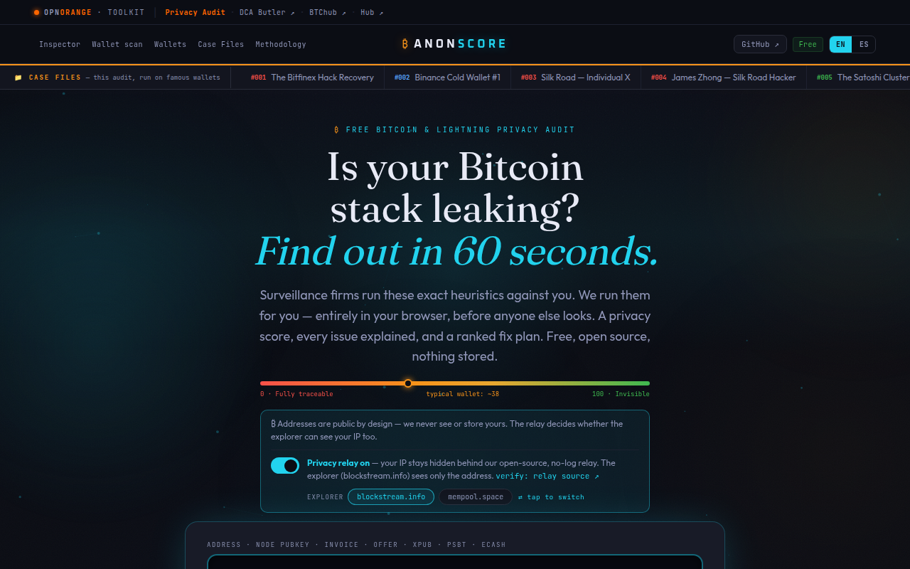

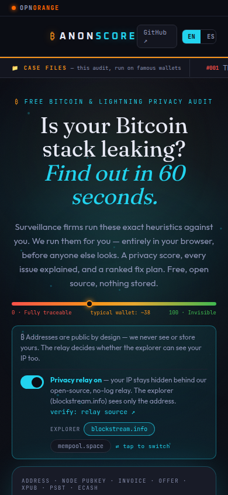

On a phone the GitHub control also wraps onto two lines because the nav is a three-column grid with an empty left column.

### 2. A floating assistant covers the result you just asked for

Finishing a scan mounts a fixed “Privacy Assistant” card (bottom-right, or nearly full-width on a phone) without a click. It sits on top of the fix list, the cluster view, the UTXO list, and the “demo loaded” toast. The same offer is already an in-flow card above the fixes, so the assistant appears twice and the fixes appear third.

The in-flow card says “only your score and issue names are shared.” The consent dialog, which is the accurate one, sends each finding’s plain-English explanation and the recommended actions. On Lightning the gap is worse: the inline “I understand” step repeats “issue names only” and never shows the payload `AiAssistant` actually posts.

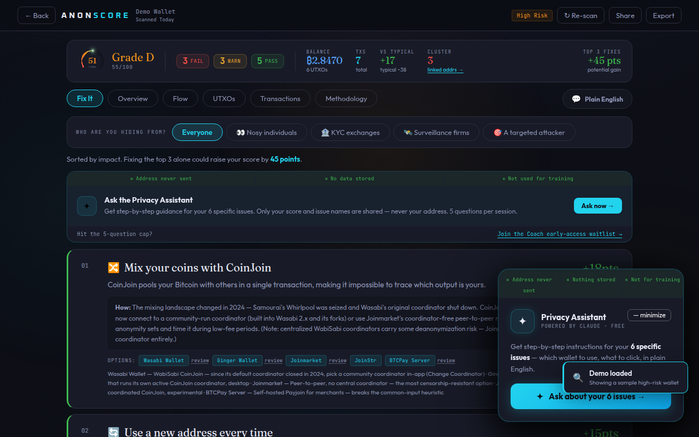

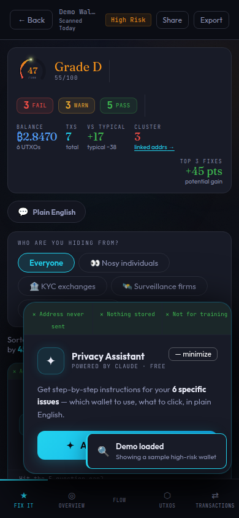

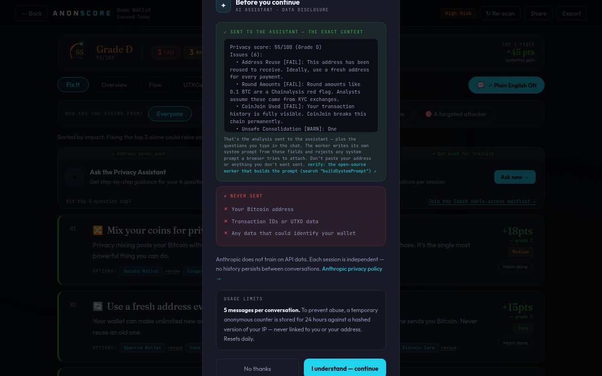

### 3. The shared-link confirm contradicts the relay

`?scan=` correctly waits for a click. The dialog then says the lookup “queries a public block explorer directly” and that “the explorer sees your IP alongside it.” Directly behind the dialog, the default state is **Privacy relay on**, which exists so the explorer does not see that IP. The button says “Scan it” while the hero button says “Analyze.”

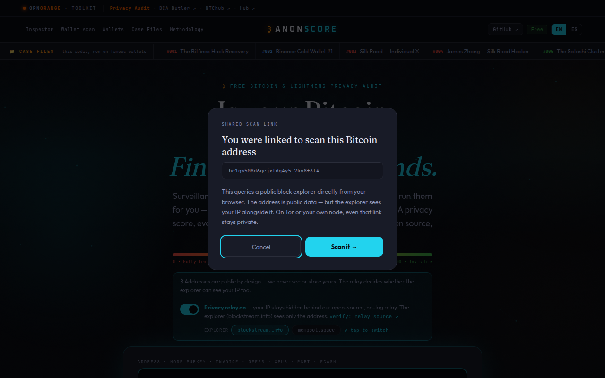

### 4. The scan animation claims 10 checks

The landing, the methodology page, and the share text all say **11** Bitcoin heuristics. The scanning screen says `RUNNING 10 CHECKS`.

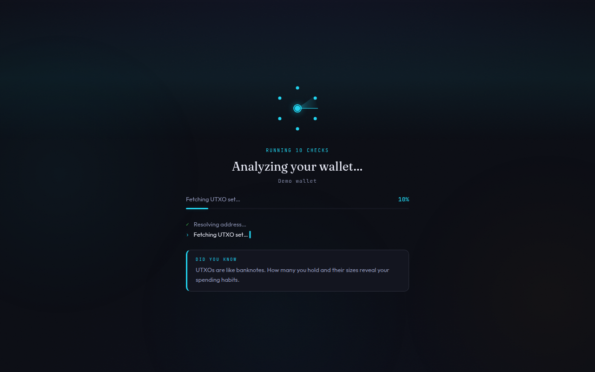

### 5. The score ring shows the wrong number while it counts

The compact ring animates from 0 over about 1.7s. Next to it, the label is already the final score. A Lightning demo captured mid-count read **4** in the ring and **44/100** beside it. A Bitcoin demo read 51, then 47, then settled at 55.

### 6. Phone “example scores” do not run the example you tapped

The three mobile cards show grades F, C, and A. Every card calls `onAnalyze("DEMO")`, the risky wallet. The desktop block under them is labeled “LIVE EXAMPLE” and is a rotating fake, not a scan.

## Medium

### 7. The same destinations are repeated until the footer

Case files: ticker, nav, footer. Toolkit: strip and footer again (on a phone the strip hides the links, so the footer is the only copy — and it is the second copy on desktop). GitHub: nav button, a link inside the scan console, and the footer. Trust: the six guarantees render as a side rail at ≥1500px and again as “Don’t trust. Verify.” The final call-to-action repeats the hero, including “~38/100.”

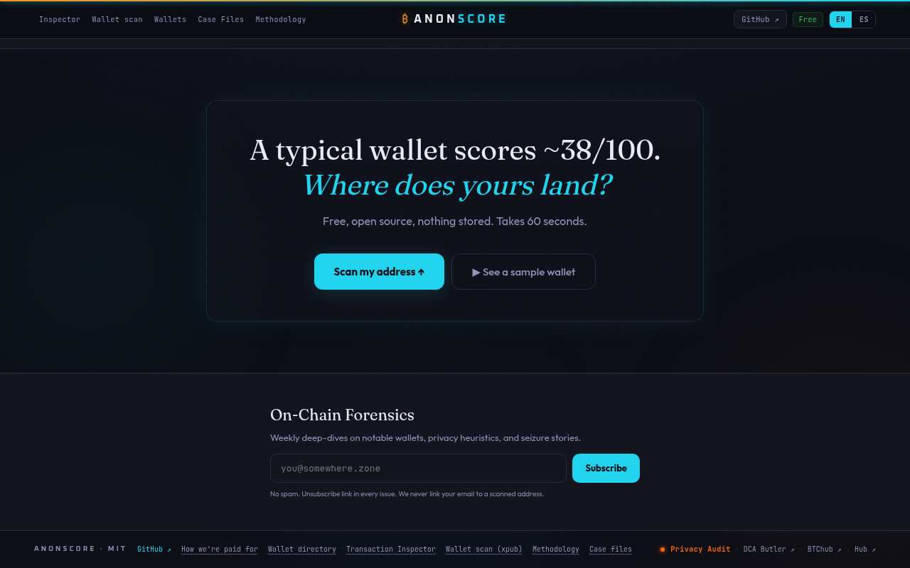

### 8. The input introduces every format before the common case

The field label is `ADDRESS · NODE PUBKEY · INVOICE · OFFER · XPUB · PSBT · ECASH`. An unrecognized paste dumps that list again as an error. Detection itself works well — a Bitcoin address, a node pubkey, and an xpub each get a clear next step — but the first-time label teaches the advanced cases first.

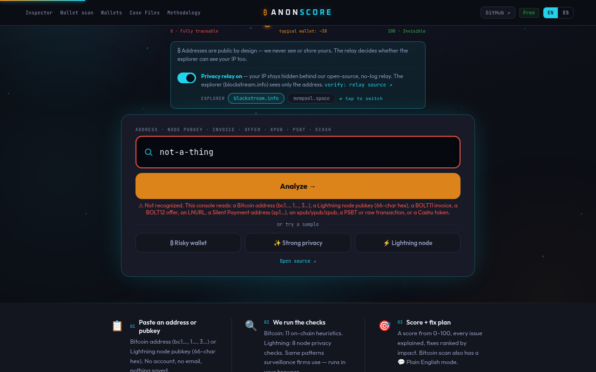

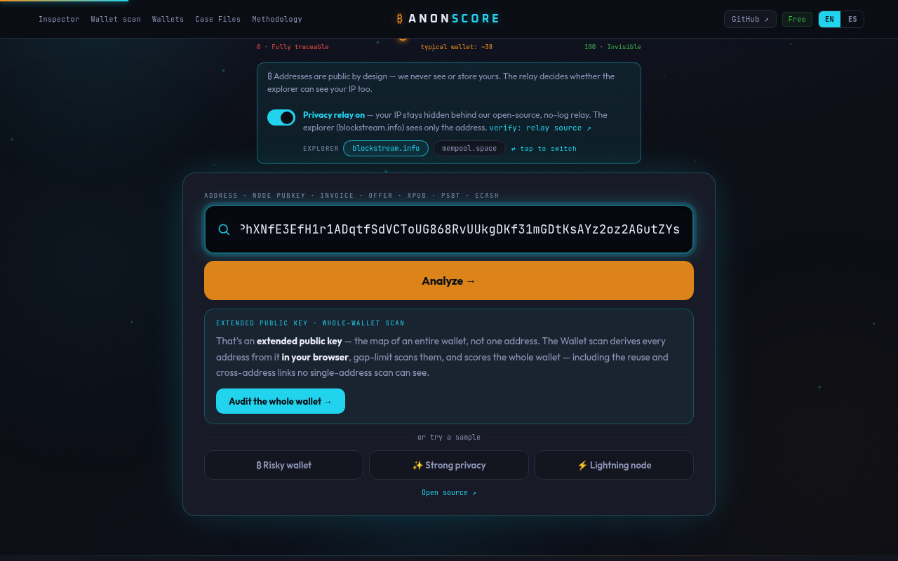

### 9. Results open on a decision, not on the fix

Fix It is the right default tab. Above the first recommendation: a dense stat bar (fail/warn/pass, balance, txs, vs typical, cluster, top-3), six tabs, Plain English, “Who are you hiding from?” (five pills), then the assistant card. The adversary ranking is useful and should stay; it should not be the first thing. On a phone there are two `position: fixed` tab bars stacked on the same edge (one of them has no icon for Flow).

Overview explains the points clearly. Flow explains the cluster in plain language. Both are partly hidden by the floating card.

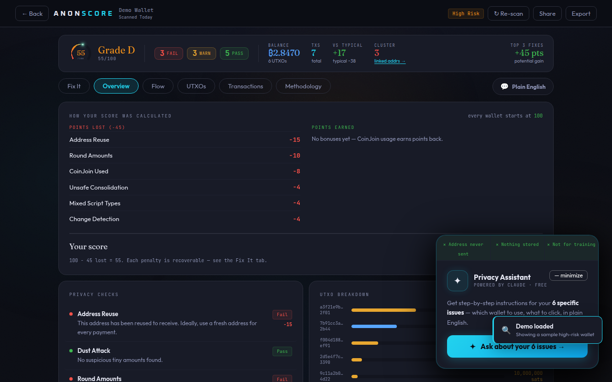

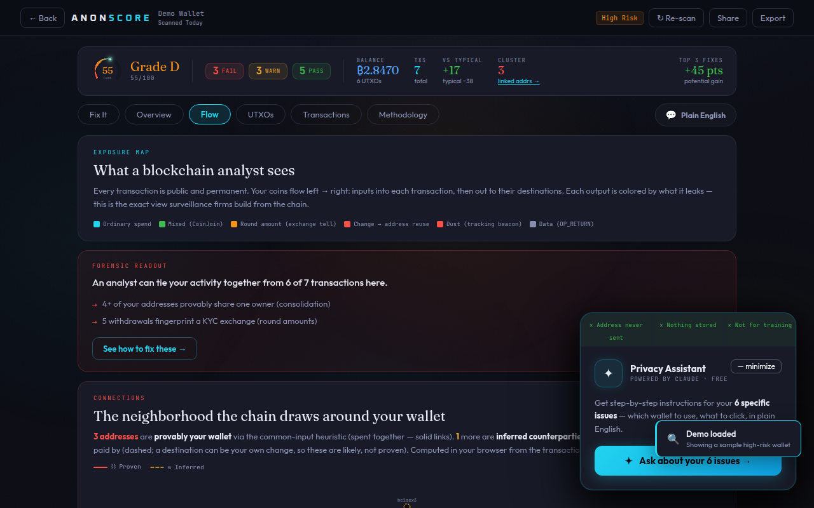

### 10. UTXO amounts change unit mid-list

`fmt.btc` switches at 1 BTC, so one row is `₿1.2000` and the next is `84,700,000 sats`. The rows are hard to compare. The expanded row already shows raw satoshis.

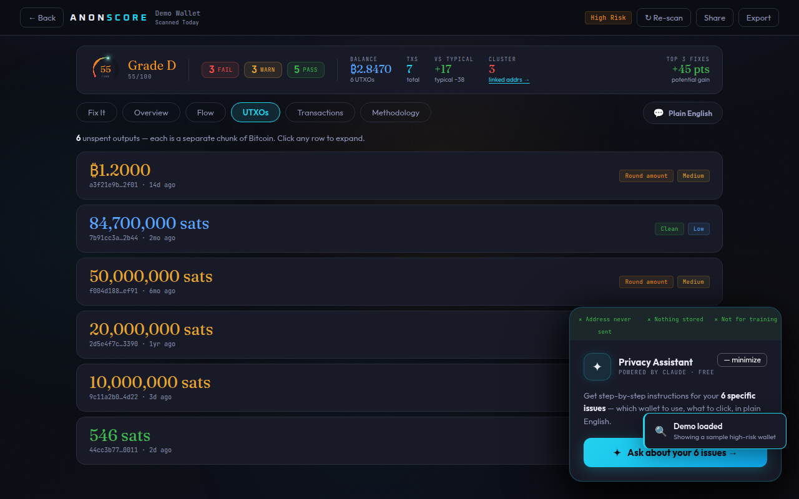

### 11. Ginger Wallet has no way out

The directory lists Ginger Wallet. It is not in `TOOL_URL`, so that card has no Visit link. Every other reviewed tool does. (RaspiBlitz’s homepage did not complete a TLS handshake from this environment; the link is left as-is.)

### 12. Words for the same action drift

Analyze, Audit, Scan, Inspect, and Reveal are all the verb for “run this.” Addresses use Analyze in the hero and Scan in the closing button and the confirm dialog. Transactions correctly use Inspect. The short nav says Inspector; the footer says Transaction Inspector. Wallet scan, xpub, and “whole wallet” are one tool.

### 13. Recent scans are easy to miss

History renders only under the console. Because the console is below the fold, coming back from a scan does not show the history you just created until you scroll past the relay card. Delete controls are an 8px “CLEAR ALL” and an unlabeled ✕.

## Lower, left alone

- Inspector, wallet-scan, methodology, and case-file pages already lead with one job. The Inspector’s empty state on a phone is the clearest screen in the product. See `d1280-20-inspector.png`, `m390-20-inspector.png`, `d1280-21-psbt.png`, `d1280-22-xpub-report.png`.
- Plain English, share (copy / post / Nostr / badge / card), export, relay source link, and “How we’re paid for” all work and say what they do.
- The address-poisoning banner did not appear on the risky demo (no lookalike in that fixture). The empty state is “no banner,” which is correct.
- Toolkit and wallet homepages that were checked resolved, including OPNorange, DCA Butler, and BTChub. `nodl.it` redirects to `nodl.eu`. `learn.robosats.com` redirects to `learn.robosats.org`.
- No horizontal page overflow at either width. No console errors on the walked flows.
- Live homepage matched this branch’s landing (toolkit, case ticker, relay card, clipped input).

## What the consolidation should protect

One path: paste, analyze, read the score, do the first fix. Advanced formats, explorer choice, adversary ranking, and the assistant stay reachable. Case files, Inspector, wallet scan, the directory, and methodology stay linked. Scoring output stays identical.
